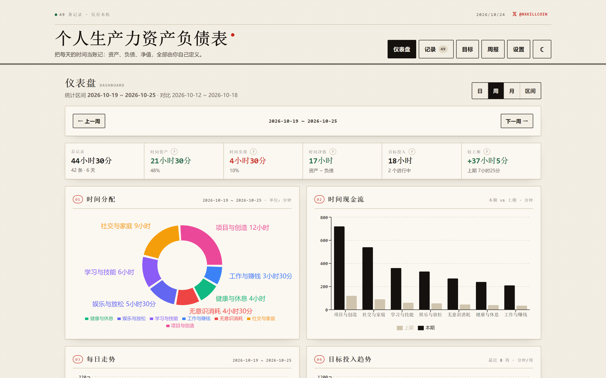
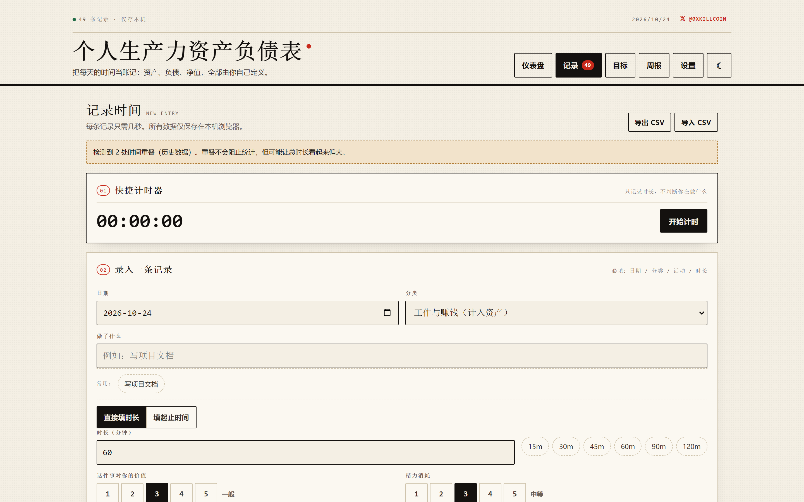
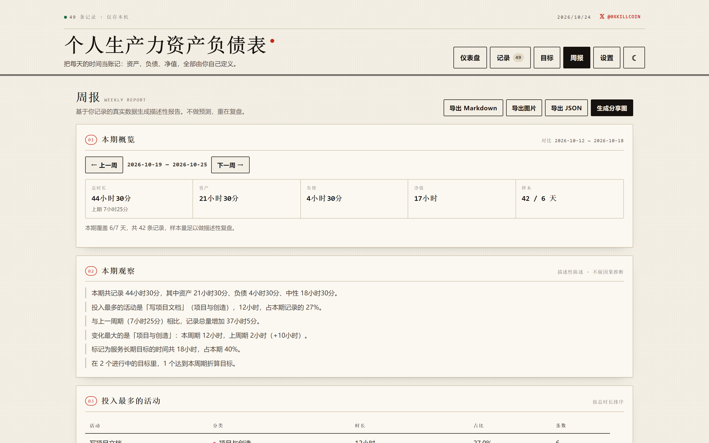
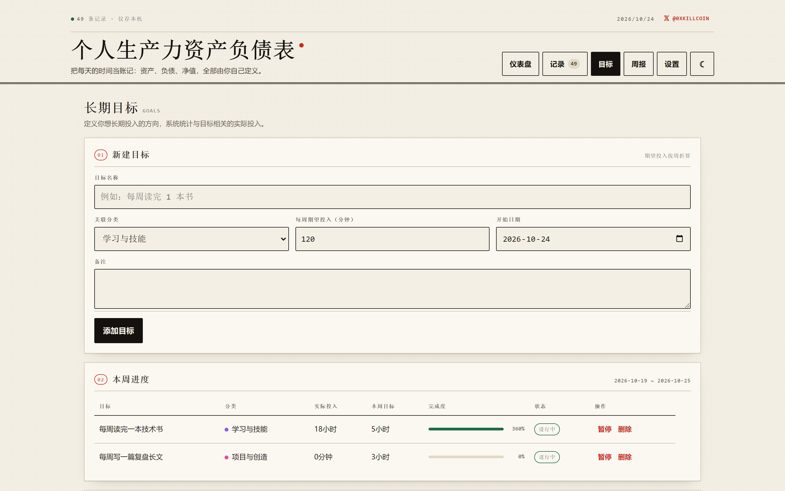
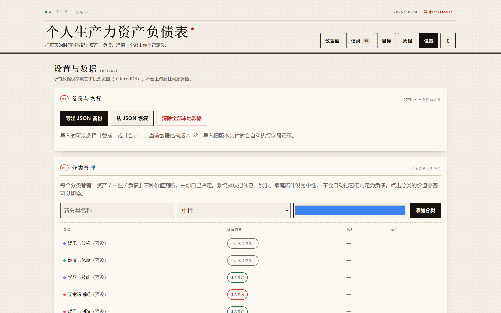
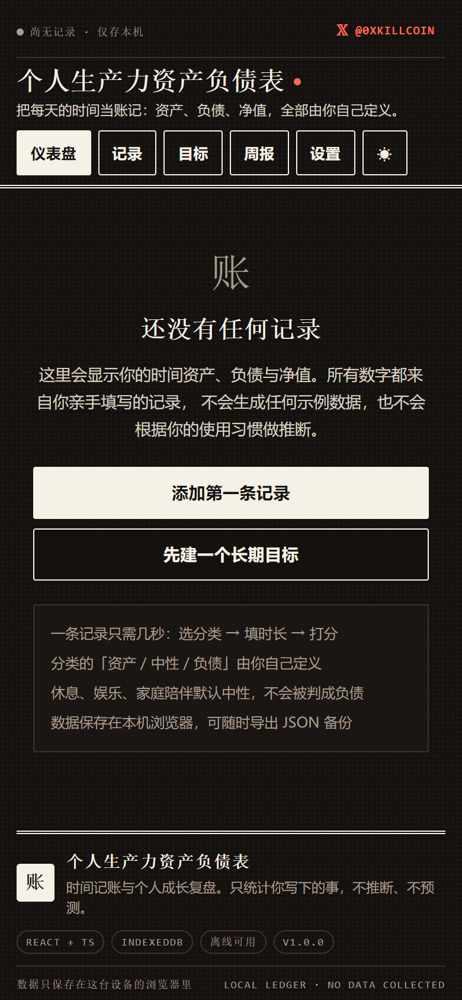
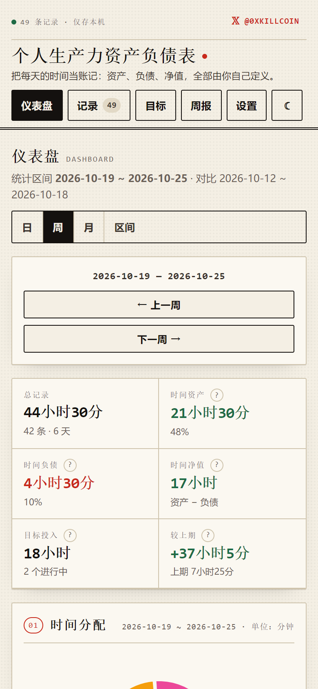

# 人生账本 · Life Ledger

> 把每天的时间当账记：**时间资产 / 时间负债 / 时间净值 / 时间现金流**，口径全部由你自己定义。
> 本地优先，无账号、无后端、无上传。所有数字只来自你亲手写下的记录。

<p>
  <a href="https://x.com/0xkillcoin"></a>
  
  
  
  
  
</p>

**作者 𝕏：[https://x.com/0xkillcoin](https://x.com/0xkillcoin)**

---

## 这是什么

一个**时间记账工具**，不是待办清单。

待办清单记录「我要做什么」，人生账本记录「我实际把时间花在哪、值不值、耗不耗神」，
然后把时间投入转成四张报表：

| 报表 | 回答的问题 |
| --- | --- |
| 时间资产 | 我主动投入了多少（学习、技能、项目、服务长期目标的时间） |
| 时间负债 | 我认定被消耗了多少（你自己标为「无意识消耗」的那部分） |
| 时间净值 | 资产 − 负债，一个内部对比口径 |
| 时间现金流 | 各分类这一期流入多少、比上期变了多少 |

再加两条辅助指标：

- **注意力成本** = Σ 时长 × (精力消耗 ÷ 3)，衡量「这些小时有多费神」
- **长期目标投入** = 你勾选了「服务于长期目标」的时间，按周聚合

> ⚠️ 这里的「资产 / 负债 / 净值」是**产品内部的分析口径**，由你给分类设定的价值判断聚合而来，
> 不是衡量一个人价值的科学公式。周报只描述已发生的事，不做因果推断，也不预测未来。

---

## 它不是

- ❌ **不是评分器**：休息、娱乐、家庭陪伴默认是**中性**，系统不会替你判定成负债。只有你亲手把某个分类标为「负债」，它才计入负债。
- ❌ **不是预测工具**：周报只复盘已经发生的事。样本不足时会明确写「样本偏少」，不会假装能预测你下周会怎样。
- ❌ **不是云端 SaaS**：没有账号、没有服务器、没有埋点。数据在你自己的浏览器里。

---

## 截图

<table>
<tr>
<td width="50%"><br><sub><b>仪表盘</b> · 账簿指标 + 四张图 + 最近记录</sub></td>
<td width="50%"><br><sub><b>记录</b> · 计时器 / 录入 / 批量操作</sub></td>
</tr>
<tr>
<td><br><sub><b>周报</b> · 观察 + 建议 + 可改写 + 多格式导出</sub></td>
<td><br><sub><b>目标</b> · 期望投入 vs 实际投入</sub></td>
</tr>
<tr>
<td><br><sub><b>设置</b> · 备份 / 分类 / 模板 / 隐私</sub></td>
<td><br><sub><b>深色模式</b> · 墨纸主题，移动端</sub></td>
</tr>
</table>

<p align="center">
  
  <br><sub>iPhone 视口：刊头压缩为 159px，导航横滑，图表单列</sub>
</p>

---

## 快速开始

```bash
git clone https://github.com/iiiiiiiiiiiiiKK/life-ledger.git
cd life-ledger
pnpm install     # 或 npm install
pnpm dev         # → http://127.0.0.1:5173
```

生产构建：

```bash
pnpm build       # 产物在 dist/
pnpm preview     # 本地预览
```

在线试用：**https://iiiiiiiiiiiiiKK.github.io/life-ledger/**

---

## 功能清单

### 记录

- 一条记录只需几秒：选分类 → 填时长（或起止时间）→ 打两个分 → 保存
- **起止时间模式**自动推算时长，跨午夜（23:00 → 01:00）正确算 2 小时并打上「跨夜」标记
- **校验**：零/负时长、超 24 小时、非法日期、非法时间、同一时间段重叠——全部拦截并给出可读错误
- **常用模板**：把常做的事存成模板，一键填表
- **快捷计时器**（可选）：刷新页面不丢、暂停后不自动继续、重复启动不累加、系统时钟回拨会告警
- **批量操作**：多选后批量改分类 / 批量删除；单条随时编辑
- **CSV 导入导出**：RFC 4180 转义，支持中英文列名，往返一致；坏行会跳过并报告行号

### 人生财报

- 恒等式：`资产 + 负债 + 中性 = 总时长`（一条记录只进一个桶，判定顺序：负债 > 资产 > 中性）
- 每个指标的公式都能在界面上点 `?` 展开查看
- **不会**把休息、娱乐、家庭时间自动判成负债

### 仪表盘

- 区间切换：日 / 周 / 月 / 自定义
- 四张图：时间分配（饼）、时间现金流（本期 vs 上期柱）、每日走势（线）、目标投入趋势（周柱）
- 今日分配、注意力成本、最近记录
- 零数据时是**干净的引导页**，不显示任何伪造统计

### 长期目标

- 名称 + 分类 + 每周期望投入 + 起止日期
- 实际投入 vs 本期折算目标（不足一周按天数折算），完成度可超 100%

### 周报

- 基于真实记录生成：总量、结构变化、投入最多的活动、目标完成度、低价值消耗、与上期对比
- **样本不足会明说**：「本期仅覆盖 2/7 天，样本偏少，以下数字只反映已记录的部分」
- 可手动改写文字，导出 **Markdown / PNG / JSON**

### 分享图

- 1:1 方图 与 3:4 竖图
- 内容自选：本周投入排行、资产/负债摘要、隐藏任意分类、自定义标题
- **备注永不进入分享图**
- Canvas 本地渲染，导出前可预览

### 数据

- IndexedDB 本地存储（库名 `ppbs`），带 `schemaVersion` 与迁移函数
- JSON 备份 / 恢复（可选替换或合并）
- 一键清除全部本地数据

---

## 指标口径

| 指标 | 公式 | 判定规则 |
| --- | --- | --- |
| 时间资产 | Σ 资产分类时长 + Σ 服务长期目标时长 | 分类设为「资产」→ 资产；中性分类但勾选长期目标 → 资产；负债优先 |
| 时间负债 | Σ 负债分类时长 | **只有**被标为「负债」的分类才计入 |
| 时间净值 | 时间资产 − 时间负债 | 内部对比口径，非个人价值评价 |
| 时间现金流 | 各分类本期时长；变化 = 本期 − 上期 | 时间无法储存，"流入流出"只是结构变化的比喻 |
| 注意力成本 | Σ 时长 × (精力消耗 ÷ 3) | 以精力 3 分为 1.0 基准的等效分钟 |
| 长期目标投入 | Σ 勾选「服务于长期目标」的时长 | 完成度 = 实际 ÷（期望周投入 × 区间周数） |

**一个记录只进一个桶**，所以恒等式永远成立。这也意味着「中性」不是一个垃圾桶，
而是你还没决定该算什么的那些时间——它同样被如实记录、如实展示。

---

## 界面设计

参考「人话翻译局」的设计语言：**编辑部刊头 + 账簿报表**。

| 元素 | 做法 |
| --- | --- |
| 纸张 | 米白底 `#f4efe4` + 4px 网点纹理；深色为墨纸 `#14110f` |
| 刊头 | `3px double` 双细线，衬线大标题 + 朱红小圆点 |
| 字体 | 标题走宋体系（Songti / Noto Serif），正文苹方，数字等宽 `tabular-nums` |
| 颜色 | 单一强调色朱红 `#c8291b`；语义色只有绿（资产）和红（负债） |
| 圆角 | 统一 2px，近似纸页直边 |
| 编号 | 每个面板带 `01 / 02` Mono 徽章，呼应报表小节 |
| 页脚 | 三段式 colophon：印章方块 + 说明 + 技术标签 |

图表统一用墨色 + 中性灰 + 单一强调色，不用彩虹配色。

### 响应式

| 断点 | 行为 |
| --- | --- |
| ≥1025px | 版心 1360px 居中，图表两列，卡片同行等高 |
| 861–1024px | 图表仍两列，内边距收窄 |
| ≤859px | 刊头压缩到 159px，导航横滑，图表单列 |
| ≤480px | 统计两列，日期隐藏，计时器数字居中，筛选整行 |
| 触摸设备 | 输入控件 ≥44px 高，评分按钮 40px，表格复选框整格可点 |

其他细节：`env(safe-area-inset-*)` 适配刘海屏、`100dvh` 规避 iOS 地址栏跳动、
所有输入 `font-size: 16px` 防止 iOS 聚焦缩放。

---

## 技术栈

- **React 19** + **TypeScript** + **Vite 8**
- 图表 [Recharts 3](https://recharts.org/)
- 路由 React Router 7（Hash 模式，静态托管零配置）
- 持久化：浏览器原生 IndexedDB（无第三方 ORM）
- 测试 Vitest 5 + Testing Library + fake-indexeddb
- 浏览器自检 puppeteer-core（可选，需要本机 Chrome）

零后端、零环境变量、零服务端函数。

---

## 项目结构

```
src/
├── components/
│   ├── MetricExplain.tsx   # 指标公式说明弹层
│   ├── SectionTitle.tsx    # 编号小节标题 / 空图表占位
│   └── ShareCard.tsx       # 分享图配置与导出
├── hooks/
│   ├── useIsNarrow.ts      # 窄屏媒体查询（图表降级用）
│   └── useTimer.ts         # 计时器（持久化 / 暂停 / 防重复启动）
├── lib/
│   ├── dates.ts            # 本地日期、周一为周起点、跨月跨年
│   ├── metrics.ts          # 财报聚合引擎、重叠检测、目标进度
│   ├── reports.ts          # 周报生成与 Markdown 导出
│   ├── reportImage.ts      # 周报 PNG 渲染
│   ├── share.ts            # 分享图 Canvas 渲染
│   ├── timer.ts            # 计时器纯状态机（可单测）
│   ├── validation.ts       # 草稿校验与草稿 ⇄ 记录转换
│   ├── csv.ts              # CSV 解析与生成
│   └── utils.ts
├── pages/                  # Dashboard / Records / Goals / Reports / Settings
├── store/
│   ├── db.ts               # IndexedDB + schema 迁移 + 备份恢复
│   └── DataContext.tsx     # 全局数据状态
├── test/                   # 121 个用例
└── types/index.ts          # 统一类型与系统分类
```

---

## 测试

```bash
pnpm test        # watch
pnpm test:run    # 单次
pnpm build       # 含 tsc 类型检查
```

最近一次结果（Node 24 / Windows）：

```
 ✓ src/test/validation.test.ts  (16 tests)
 ✓ src/test/csv.test.ts         (16 tests)
 ✓ src/test/metrics.test.ts     (27 tests)
 ✓ src/test/dates.test.ts       (11 tests)
 ✓ src/test/acceptance.test.ts  (16 tests)
 ✓ src/test/storage.test.ts     ( 9 tests)
 ✓ src/test/timer.test.ts       (10 tests)
 ✓ src/test/reports.test.ts     (10 tests)
 ✓ src/test/smoke.test.tsx      ( 6 tests)

 Test Files  9 passed (9)
      Tests  121 passed (121)
```

### 验收场景对照

| 场景 | 覆盖用例 |
| --- | --- |
| 新用户零数据状态 | `acceptance.test.ts` 零数据状态；`smoke.test.tsx` 空状态且无伪造统计 |
| 正常录入与修改 | `smoke.test.tsx` 真实点击保存；`validation.test.ts` 草稿 ⇄ 记录 |
| 同一天多条记录 | `metrics.test.ts` 三条同日记录全部计入 |
| 跨午夜活动 | `dates.test.ts` 时长推导；`acceptance.test.ts` 计入开始日 |
| 重叠与异常输入 | `metrics.test.ts` 重叠检测；`validation.test.ts` 负数/超 24h/非法日期 |
| 日 / 周 / 月统计 | `metrics.test.ts` 区间边界；`acceptance.test.ts` 三种区间 |
| 上周与本周对比 | `metrics.test.ts` previousPeriod；`acceptance.test.ts` 环比数值 |
| CSV / JSON 导入导出 | `csv.test.ts` 转义与往返；`storage.test.ts` 替换/合并 |
| 刷新恢复与数据清除 | `smoke.test.tsx` 重新挂载后仍在；`storage.test.ts` 清空后恢复默认分类 |
| 汇总与原始记录一致 | `acceptance.test.ts` 总量 / 占比 / 分档 / 目标进度全部核对 |

### 浏览器端自检（可选，需本机 Chrome）

```bash
pnpm dev
node scripts/responsive-check.mjs   # 6 视口 × 5 页：溢出 / 越界 / 点击区
node scripts/interaction-check.mjs  # X 链接 / 主题 / 导航 / 录入保存
node scripts/design-audit.mjs       # 明暗 × 5 页：WCAG 对比度 / 裁切 / 字号
node scripts/screenshot.mjs         # 生成 12 张截图到 _shots/
```

当前结果：

```
responsive   6/6 视口 PASS   溢出 0px · 越界 0 · 小点击区 0 · 报错 0
interaction  18/18 项 PASS
design       未发现对比度/裁切问题
```

这套自检在开发中真实抓到并修掉了 8 类缺陷（表格撑破布局、Recharts 标签越界、
进度条脱离文档流、刊头过高、图例对比度不足、深色徽标对比度、iOS 输入缩放、
复选框命中区过小），修复记录见 [提交历史](https://github.com/iiiiiiiiiiiiiKK/life-ledger/commits/main)。

---

## 部署

### GitHub Pages（本仓库已配置）

推送到 `main` 即自动构建并发布，工作流见 [`.github/workflows/deploy.yml`](.github/workflows/deploy.yml)。

首次启用需在仓库 **Settings → Pages → Source** 选择 `GitHub Actions`。

### 任意静态托管

```bash
pnpm build
# 把 dist/ 上传即可
```

`vite.config.ts` 用 `base: './'` 相对路径，可直接丢到任意子目录。
Hash 路由（`#/records`），不需要服务端 history fallback。

<details>
<summary>Nginx 示例</summary>

```nginx
server {
  listen 80;
  root /var/www/life-ledger/dist;
  index index.html;
  location / { try_files $uri $uri/ /index.html; }
}
```
</details>

<details>
<summary>Vercel / Netlify 示例</summary>

- Build command: `pnpm build`
- Output directory: `dist`
- 无需环境变量与服务端函数
</details>

---

## 数据与隐私

- 所有数据在浏览器 IndexedDB（库名 `ppbs`），**不会上传任何服务器**
- 不强制注册、无账号体系、无遥测、无 Cookie 追踪
- 清除浏览器站点数据会删除本地数据 → 请定期在「设置」页导出 JSON 备份
- 分享图默认不含活动备注，导出前可预览
- 唯一的外链是作者的 X 主页，点击才会离开本页

**换设备怎么办？** 目前没有同步。用「设置 → 导出 JSON 备份」，在新设备「从 JSON 恢复」。
这是刻意的取舍：不上传数据，就不需要相信任何人。

---

## 已知限制

1. **无跨设备同步**：第一版没有账号与后端，靠 JSON 备份手动迁移
2. **多标签页并发写入未做冲突合并**：建议单标签使用
3. **单条记录最长 24 小时**：跨多天的活动需拆成多条
4. **重叠时间只提示不阻断**：历史数据里的重叠不影响统计，但总时长可能偏大
5. **时钟回拨只检测不修复**：系统时间被往回调整时，计时器按 0 计并告警
6. **趋势图缺失周期补 0，不插值**：避免制造不存在的连续趋势
7. **周报样本不足仍会生成**：会明确标注「样本偏少」
8. **打包体积约 770 kB（gzip 229 kB）**：主要来自 Recharts，尚未做代码分割
9. **移动端宽表格横向滚动**：保持原列宽，不压缩成难读的卡片
10. **Canvas 图片字体依赖系统**：不同设备排版可能有细微差异

---

## 路线图

- [ ] 可选账号 + 后端同步（当前版本不承诺，也未伪装成本地已有）
- [ ] PWA 离线安装
- [ ] 图表代码分割，减小首屏体积
- [ ] 移动端宽表格的卡片式展示模式
- [ ] 年度视图与多周期对比

---

## 支持这个项目

它是完全免费、无广告、无付费墙的工具。如果它帮到了你，可以请我喝杯咖啡——
**不打赏也完全免费用，功能不做任何限制。**

<p>
  
  <br>
  <sub>扫码打赏 · 完全自愿</sub>
</p>

---

## License

[MIT](LICENSE) © [@0xkillcoin](https://x.com/0xkillcoin)
